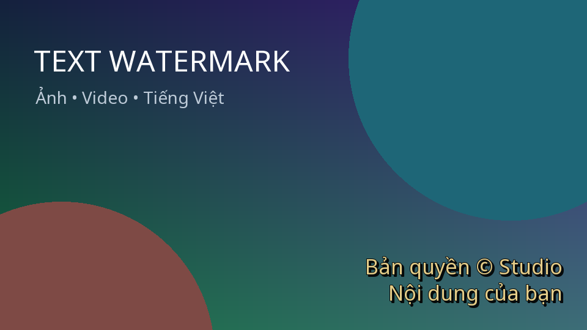

# ComfyUI Text Watermark

Node **Text Watermark (Image & Video)** đóng watermark chữ cho ảnh và batch
khung hình video trong ComfyUI. Có sẵn font Noto Sans hỗ trợ tiếng Việt.



## Tính năng

- Nội dung nhiều dòng, font `.ttf`/`.otf`, cỡ chữ theo pixel.
- Màu HEX (`#FFFFFF`, `#F9A825`) hoặc tên màu (`white`, `red`).
- Độ mờ, 9 vị trí đặt chữ, khoảng cách mép và dịch chuyển X/Y.
- Viền chữ, bóng chữ, căn trái/giữa/phải, tự thu nhỏ chữ để vừa ảnh.
- Xử lý toàn bộ batch; giữ nguyên kích thước và thứ tự khung hình.
- Hỗ trợ RGB và RGBA; giữ chính xác pixel ngoài vùng watermark.
- Không tải dữ liệu lên dịch vụ bên ngoài, không tải font lúc chạy.

## Cài đặt bằng ZIP (dùng được ngay)

1. Giải nén thư mục `ComfyUI-Text-Watermark` vào thư mục **custom_nodes** của
   bản ComfyUI bạn đang chạy. Với Desktop, mở thư mục cài đặt/người dùng ComfyUI
   qua ứng dụng rồi tìm `custom_nodes`; không đặt vào thư mục ứng dụng đóng gói.
2. Kiểm tra cấu trúc, tránh lồng thêm một cấp thư mục:

   ```text
   ComfyUI/
     custom_nodes/
       ComfyUI-Text-Watermark/
         __init__.py
         watermark.py
         requirements.txt
         fonts/
           NotoSans.ttf
   ```

3. Cài dependencies bằng **đúng Python của ComfyUI**.

   **Windows Portable** — mở terminal tại thư mục chứa `python_embeded` và `ComfyUI`:

   ```powershell
   .\python_embeded\python.exe -m pip install -r .\ComfyUI\custom_nodes\ComfyUI-Text-Watermark\requirements.txt
   ```

   **Linux/macOS hoặc cài bằng venv** — kích hoạt môi trường ComfyUI, mở terminal
   tại thư mục `ComfyUI`:

   ```bash
   python -m pip install -r custom_nodes/ComfyUI-Text-Watermark/requirements.txt
   ```

   **Desktop** — dùng terminal/môi trường Python do bản Desktop quản lý rồi chạy
   cùng lệnh với đường dẫn đầy đủ đến `requirements.txt`. Không dùng Python hệ thống
   nếu ComfyUI đang chạy bằng một môi trường khác.

4. Khởi động lại ComfyUI, tải lại trang giao diện.
5. Nhấp đúp canvas, tìm **Text Watermark (Image & Video)**, trong nhóm `image/watermark`.

`torch` đã có trong ComfyUI nên requirements không cài lại, tránh thay nhầm bản CUDA.
Python yêu cầu từ 3.10, Pillow từ 10.1.0.

## Cài từ Git sau khi repo được push

Tại thư mục `ComfyUI/custom_nodes`, thay `<URL_REPO>` bằng repo chứa package này:

```bash
git clone <URL_REPO> ComfyUI-Text-Watermark
```

Sau đó thực hiện bước cài dependencies và khởi động lại ở trên.
Để cập nhật, chạy `git pull` trong thư mục node rồi khởi động lại ComfyUI.

## Dùng với ảnh

```text
Load Image → Text Watermark (Image & Video) → Save Image
```

Kéo `examples/image_watermark.json` vào canvas, chọn ảnh ở Load Image,
chỉnh chữ rồi nhấn Queue/Run.

## Dùng với video — node có sẵn trong ComfyUI

```text
Load Video → Get Video Components
                    ├─ images → Text Watermark → Create Video.images
                    ├─ audio ──────────────────→ Create Video.audio
                    └─ fps ────────────────────→ Create Video.fps
                                                   ↓
                                                Save Video
```

Kéo `examples/video_watermark.json` vào canvas và chọn video ở Load Video.
Workflow nối âm thanh và FPS gốc vào Create Video. Nếu dựng thủ công, nhấp phải
Create Video và chuyển `fps` thành input nếu chưa có cổng nối.

Node watermark nhận **IMAGE**, không nhận trực tiếp file MP4 hoặc cổng VIDEO.
Các node lõi đảm nhận đọc/ghi video. Bản ComfyUI thiếu Load Video/Get Video
Components/Create Video cần cập nhật ComfyUI hoặc dùng VideoHelperSuite.

### Với VideoHelperSuite (VHS)

Nối `Load Video (Upload).IMAGE → Text Watermark → Video Combine.images`.
Nối audio của Load Video vào Video Combine.audio và đặt frame_rate theo FPS nguồn
(hoặc lấy từ node thông tin video VHS). Khi dùng chế độ chia batch của VHS,
đặt watermark trong đường xử lý từng batch.

## Tham số

| Tham số | Ý nghĩa |
|---|---|
| `text` | Nội dung watermark, Enter để xuống dòng |
| `font` | Chọn font trong thư mục `fonts/` của node |
| `font_path` | Tùy chọn: đường dẫn font trên máy chạy ComfyUI; ưu tiên hơn `font` |
| `font_size` | Cỡ chữ pixel; font hỗ trợ tiếng Việt mới hiển thị đủ dấu |
| `color` | Màu chữ, ví dụ `#FFFFFF`; dùng opacity để chỉnh trong suốt |
| `opacity` | 0 = ẩn, 1 = rõ hoàn toàn; áp dụng cả chữ, viền, bóng |
| `position` | 9 vị trí; mặc định góc dưới phải |
| `margin` | Khoảng cách mép ảnh đến toàn bộ cụm chữ/viền/bóng |
| `offset_x`, `offset_y` | Dịch ngang/dọc theo pixel; số dương = sang phải/xuống |
| `stroke_width`, `stroke_color` | Độ dày và màu viền; 0 = tắt |
| `shadow` | Bật/tắt bóng chữ |
| `shadow_color`, `shadow_x`, `shadow_y` | Màu và khoảng dịch bóng; bóng có cạnh sắc |
| `line_spacing`, `alignment` | Khoảng cách và căn lề các dòng chữ |
| `fit_text` | Tự giảm cỡ chữ để vừa khoảng trống còn lại sau margin |

**Thêm font:** chép `.ttf`/`.otf` vào `fonts/` rồi khởi động lại ComfyUI và tải lại UI.
Hoặc nhập đường dẫn đầy đủ vào `font_path`. Font phải nằm trên **máy chủ chạy
ComfyUI**, không phải máy chỉ mở trình duyệt. Thay file font cùng tên cũng được
phát hiện để chạy lại node. Font Noto Sans mặc định được phân phối theo SIL OFL;
chi tiết tại `fonts/OFL.txt`. Chỉ thêm font mà bạn có quyền sử dụng.

## Lưu ý thực tế

- Dành cho ảnh/video SDR với pixel trong miền 0–1; chưa xử lý quản lý màu HDR.
- Video được xử lý theo batch khung hình đã giải mã, cần RAM/VRAM tương ứng.
  Video dài nên chia batch bằng VHS hoặc cắt thành đoạn ngắn.
- Chữ rỗng hoặc opacity = 0 trả lại ảnh gốc.
- `fit_text` thu nhỏ chữ, không tự xuống dòng. Thêm xuống dòng thủ công nếu cần.
  Offset cố ý đẩy chữ ra ngoài ảnh vẫn bị cắt tại mép; tắt fit_text cũng có thể cắt chữ.
  Canvas quá nhỏ để chứa cả chữ/viền/bóng sẽ được cắt theo kích thước canvas.
- Xuất MP4 là mã hóa lại video; không hứa giữ nguyên bitrate/chất lượng nén nguồn.
- Font tùy chỉnh phải có glyph tiếng Việt; node không thay font thiếu glyph tự động.

## Khắc phục lỗi

- **Không thấy node / IMPORT FAILED:** kiểm tra log ComfyUI, cấu trúc thư mục và
  cài requirements bằng đúng Python, sau đó restart.
- **Không tìm thấy font:** kiểm tra `font_path`; để trống để dùng dropdown.
- **Không thấy chữ:** kiểm tra opacity, màu chữ, offset, margin và cỡ chữ.
- **Video mất tiếng / sai tốc độ:** kiểm tra các dây audio và fps như sơ đồ.
- **Workflow báo thiếu node:** cập nhật ComfyUI; ví dụ video dùng các node video lõi.

## Kiểm thử cho lập trình viên

Trong môi trường phát triển riêng:

```bash
python -m pip install -r requirements.txt torch pytest
python -m pytest -q
```

Các test dùng tensor thật để kiểm tra batch, RGB/RGBA source-over, opacity,
font, vị trí, clipping, giữ nguyên ảnh nguồn và nạp package độc lập.

Tài liệu upstream: [custom node IMAGE](https://docs.comfy.org/custom-nodes/backend/datatypes),
[các node video](https://github.com/Comfy-Org/ComfyUI/blob/master/comfy_extras/nodes_video.py),
[Noto Sans](https://github.com/google/fonts/tree/main/ofl/notosans).
